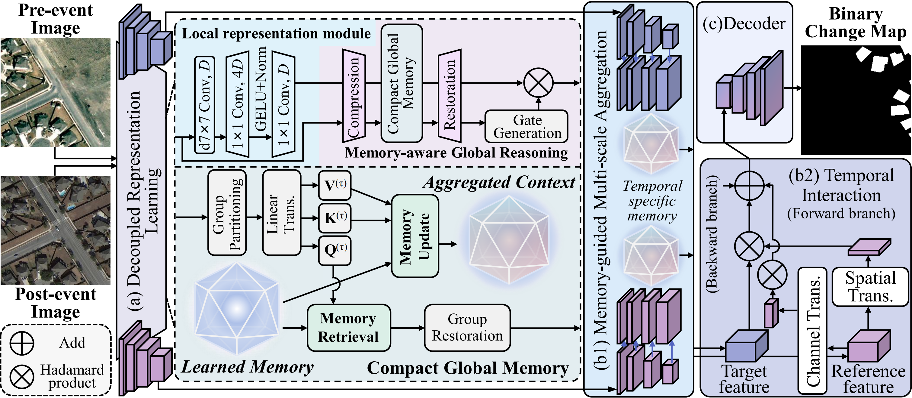

<h1 align="center">ChangeDMA</h1>

<h3 align="center">Beyond Entanglement: Decoupled Memory Aggregation for Remote Sensing Change Detection</h3>

## 🔭Overview



## 🗝️Quick start on LEVIR dataset

1. Data preparation:

   - Download LEVIR dataset from [Here](https://justchenhao.github.io/LEVIR/) (Official) or [AI Studio](https://aistudio.baidu.com/datasetdetail/53795) (Spare).

   - Crop the images & masks into $256\times 256$ size.

   - Arrange them into the following format:

     ```
     data
     |- LEVIR
        |- ABlabel
           |- A
              |- train_1_0_256_0_256.png
              |- ...
              |- val_1_0_256_0_256.png
              |- ...
              |- test_1_0_256_0_256.png
              |- ...
           |- B
              |- (same as above)
           |- label
              |- (same as above)
           |- list
              |- train.txt
              |- val.txt
              |- test.txt
     ```
     
     Here, each line of .txt file is a file name, like:
     
     ```
     train_1_0_256_0_256.png
     train_1_0_256_256_512.png
     train_1_0_256_512_768.png
     train_1_0_256_768_1024.png
     ...
     ```

2. Installation:

   - Create and activate a new conda environment:

     ```bash
     conda create -n changedma python=3.10
     conda activate changedma
     ```

   - Install PyTorch according to CUDA or ROCm version (taking CUDA 13.2 as an example here): 

     ```bash
     pip3 install torch==2.13.0 torchvision==0.28.0 --index-url https://download.pytorch.org/whl/cu132
     ```
   
   - Install other dependencies:
   
     ```bash
     pip install -r requirements.txt
     ```
   
4. Train:

   ```bash
   torchrun --nproc_per_node=4 train_ddp.py --model_size 'small' --pretrain_dir 'ckpts/dma_s_in1k_ema.pth'
   ```

5. Benchmark:

   ```bash
   python benchmark.py --model_size 'small' --model_path 'ckpts/changedma_s_levir.pth'
   ```
